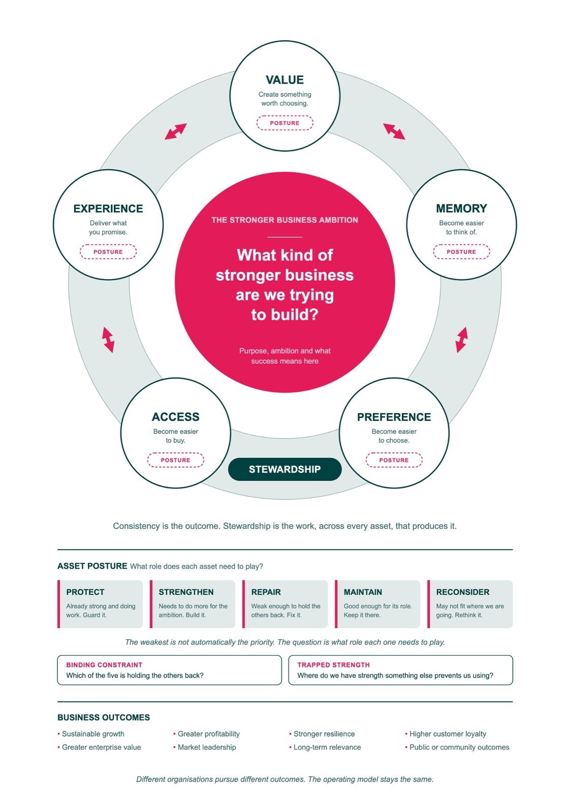

### The question is only whether it was designed deliberately or arrived by accident.

Every business already has an operating model. It may never have been written down, and nobody may be able to describe it, but it is there in the pattern of what the business invests in, what it protects, what it lets slide, and what it changes every time new people arrive.

Most of the operating models I meet arrived by accident. That is not a criticism of anybody. It is what happens when a business grows through a long series of individually sensible decisions, made by different people at different times for different reasons. The result is a business that works, that nobody fully understands, and that nobody is quite responsible for.

This page is an alternative. It sets out the Stronger Business Operating Model in full: what it is, how the parts relate, and how to use it. Over the past few months, I have written about each part on its own. This is where they come together, and it is the page I will keep pointing people to.

## **The ambition at the centre**

At the centre of the model is the Stronger Business Ambition, a clear answer to what kind of stronger business you are trying to build.

Not a vision statement, and not a revenue target. A description of the position you want the business to hold, specific enough to tell you what matters most. The easiest option in the category. The specialist everybody in the industry calls first. The brand people are pleased to have chosen. Different ambitions need different shapes of strength, and without one, every asset looks equally important, which means none of them gets the attention it deserves.

## **The five assets**

Around the ambition sit five assets. Between them, they determine whether creating demand is easy or hard.

Value is the customer’s judgement that choosing you is worth what they have to give up. Memory is whether you come to mind at all when there is a chance of being chosen. Preference is whether the balance of choice leans your way once the alternatives are in front of someone. Access is whether a person who has decided to act can do so without unnecessary effort. Experience is the evidence that tells them whether choosing you was a decision worth repeating.

They are assets because they keep working after the activity that created them has stopped, and because you can invest in them, measure them, grow them, neglect them, and spend them.

A business that harvests them without replenishing them can report strong results for a long time while becoming steadily weaker, which is the most dangerous position in business and the one the financial numbers are least able to show you.

They are not a funnel. Experience creates memory. Access changes perceived value. Preference changes how an experience is interpreted before it happens. The commercial result comes out of the system as a whole, which means strength in one place cannot indefinitely make up for weakness in another.

## **Stewardship around the edge**

Around the five sits stewardship. Consistency is the outcome every business wants; stewardship is the work that produces it. It means protecting what is creating value, strengthening what is weak, and changing what must change without needlessly destroying what has already been built.

Stewardship is drawn as a ring because it is not a sixth asset. It is the work that happens across all five, and it allows each cycle of effort to start from a stronger base than the last, rather than repeatedly paying to rebuild advantages the business already had.

## **How to use it**

The model describes what makes a stronger business. Using it follows four stages.

**Get to the Root** is about understanding the business as it is: the state of each asset, the direction each is moving in, and which of this year’s results are being paid for by earlier investment. It is diagnosis before prescription.

**Define the Focus** is about choosing. It agrees on the Stronger Business Ambition, identifies the asset currently limiting the whole, finds the strength trapped behind something else, and sets a posture for each asset: what to protect, what to strengthen, what to repair, what to maintain, and what to reconsider.

**Build the Plan** turns that focus into work, with the slow assets and the fast ones on their own clocks, the slow work started first and protected, and the fast work used to release what already exists.

**Steward the Direction** happens after the plan is written, when most strategy goes quiet. It names who is responsible for the five assets, tests significant decisions against all five before they are made, keeps a record of what was decided and why, and watches a small set of measures over years rather than quarters.

## **The eight questions**

If you use nothing else from the model, use these. They are the questions I ask at the start of every piece of work, and a leadership team that can answer all eight clearly is better positioned than most.

1. What kind of stronger business are we trying to build, and would everyone on the leadership team describe it the same way?
2. Of everything we report, what tells us whether the business is becoming stronger rather than simply what it produced last quarter?
3. Which of this year’s results came from investments we are no longer making?
4. What state is each of the five assets in, and which direction is each one moving?
5. Which asset is currently limiting the whole?
6. Where do we already have strength that something else is stopping us from using?
7. What will our next significant decision do to each of the five?
8. Who is responsible for making sure next year starts from a stronger base than this one?

## **The series**

Each part of the model has its own piece, and each one stands on its own.

1. The most dangerous position in business is performing well. ++[https://somethingdifferent.co.nz/musings/the-most-dangerous-position-in-business-is-performing-well.html](https://somethingdifferent.co.nz/musings/the-most-dangerous-position-in-business-is-performing-well.html)++
2. Businesses accumulate assets, not activity. ++[https://somethingdifferent.co.nz/musings/businesses-accumulate-assets-not-activity.html](https://somethingdifferent.co.nz/musings/businesses-accumulate-assets-not-activity.html)++
3. Your weakest asset is not your biggest problem. ++[https://somethingdifferent.co.nz/musings/your-weakest-asset-is-not-your-biggest-problem.html](https://somethingdifferent.co.nz/musings/your-weakest-asset-is-not-your-biggest-problem.html)++
4. Consistency is the outcome. Stewardship is the work. ++[https://somethingdifferent.co.nz/musings/consistency-is-the-outcome-stewardship-is-the-work.html](https://somethingdifferent.co.nz/musings/consistency-is-the-outcome-stewardship-is-the-work.html)++
5. What one decision actually costs you. ++[https://somethingdifferent.co.nz/musings/what-one-decision-actually-costs-you.html](https://somethingdifferent.co.nz/musings/what-one-decision-actually-costs-you.html)++
6. Memory takes years. Access takes weeks. ++[https://somethingdifferent.co.nz/musings/memory-takes-years-access-takes-weeks.html](https://somethingdifferent.co.nz/musings/memory-takes-years-access-takes-weeks.html)++
7. Five strong assets are not the goal. ++[https://somethingdifferent.co.nz/musings/five-strong-assets-are-not-the-goal.html](https://somethingdifferent.co.nz/musings/five-strong-assets-are-not-the-goal.html)++

## **Use it**

The model is free, and the full write-up, with the diagram and the eight questions, is here: ++[https://somethingdifferent.co.nz/musings/the-stronger-business-operating-model.html](https://somethingdifferent.co.nz/musings/the-stronger-business-operating-model.html)++.

Use it with your own leadership team. Argue with it. Change the parts that do not fit your business.

If you do use it, I would like to hear what happened, particularly where it did not work, because that is how it gets better.

And if you only take one thing from all of this, take the question that started it. Every business has an operating model. The question is only whether it was designed deliberately or arrived by accident. Which is yours?